# Ant Foraging Simulation

A **C# / Unity agent-based simulation** exploring how simple local rules can produce emergent colony behavior.

Ants search for food without global knowledge, return to their nest using an internal navigation estimate, deposit pheromones, and use pheromone trails to discover previously found food.

The project is designed as a software-engineering experiment around **agent behavior, spatial data structures, state machines, and simulation architecture**.


> **Status:** Active development  
> **Engine:** Unity 6 · **6000.4.11f1**  
> **Language:** C#  
> **Focus:** Agent-based simulation · Emergent behavior · Spatial algorithms · State machines · Data-oriented storage

---

## What the Simulation Does

The colony follows a simple feedback loop:

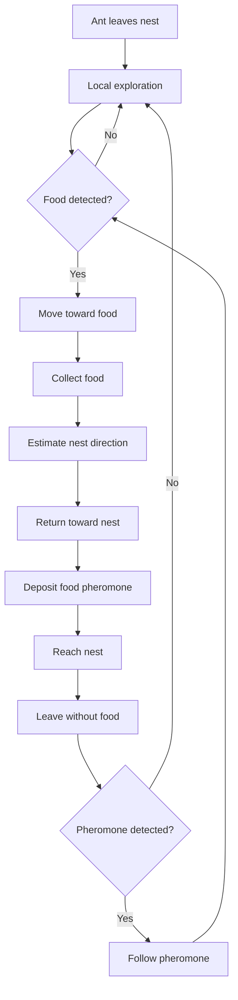

The important part is that **no central system calculates a route for the colony**.

Each ant operates from:

- Its current state
- Its local sensor observations
- Its movement history
- Its estimate of the nest direction
- Pheromone information in its immediate surroundings

The colony-level trail therefore emerges from many independent local decisions.

---

## Demo

### Colony Foraging

<!-- GIF: Replace with `docs/gifs/ant-foraging.gif` showing ants discovering food and establishing a trail. -->

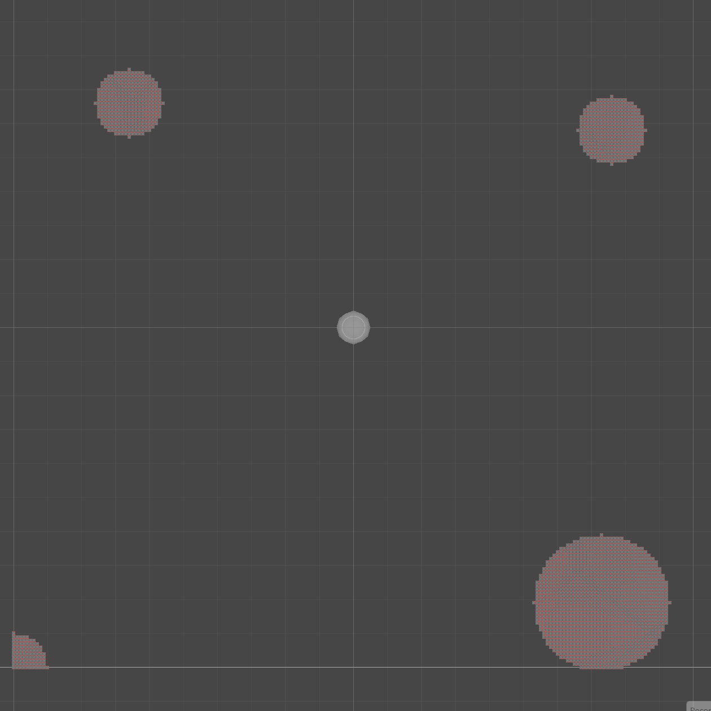

### Pheromone Formation and Decay

<!-- GIF: Replace with `docs/gifs/pheromone-decay.gif` showing a trail being deposited, reinforced and eventually decaying. -->


---

# Core Systems

## 1. Agent-Based Ant Model

Each ant is represented by a lightweight C# `struct` containing its simulation state rather than being a separate `MonoBehaviour`.

An ant maintains information such as:

- Position and orientation
- Current behavioral state
- Movement speed
- Food-carrying state
- Nest-direction estimate
- Navigation confidence
- Distance travelled
- Food-source observations
- Pheromone observations
- Sensor configuration
- Runtime metrics

This keeps the **simulation state separate from Unity's scene hierarchy**.

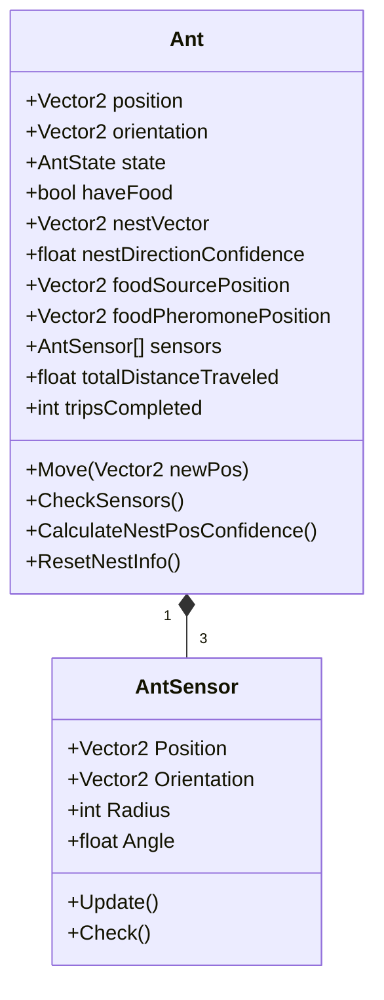

This design also makes it possible for the simulation managers to update large collections of ants without requiring a Unity component for every agent.

---

# 2. Local Sensing

Ants do not query the entire environment when making movement decisions.

Each ant has **three forward-facing sensors**:

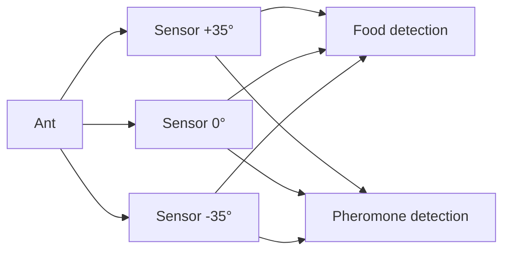

Each sensor has a configurable:

| Parameter | Purpose |
|---|---|
| Angle | Position relative to the ant's forward direction |
| Distance | How far the sensor is placed from the ant |
| Radius | Size of the local area it can inspect |
| Pheromone preference | Whether strong or weak pheromone information is preferred |

The sensors query the `FoodSourceManager` and `PheromoneManager` rather than directly accessing their internal storage.

This gives the ant a **local perception layer** between the agent and the environment.

<!-- GIF: Replace with `docs/gifs/sensors.gif` showing the three sensor regions in the Unity scene. -->

---

# 3. Explicit Ant State Machine

Ant behavior is modeled using an explicit state machine.

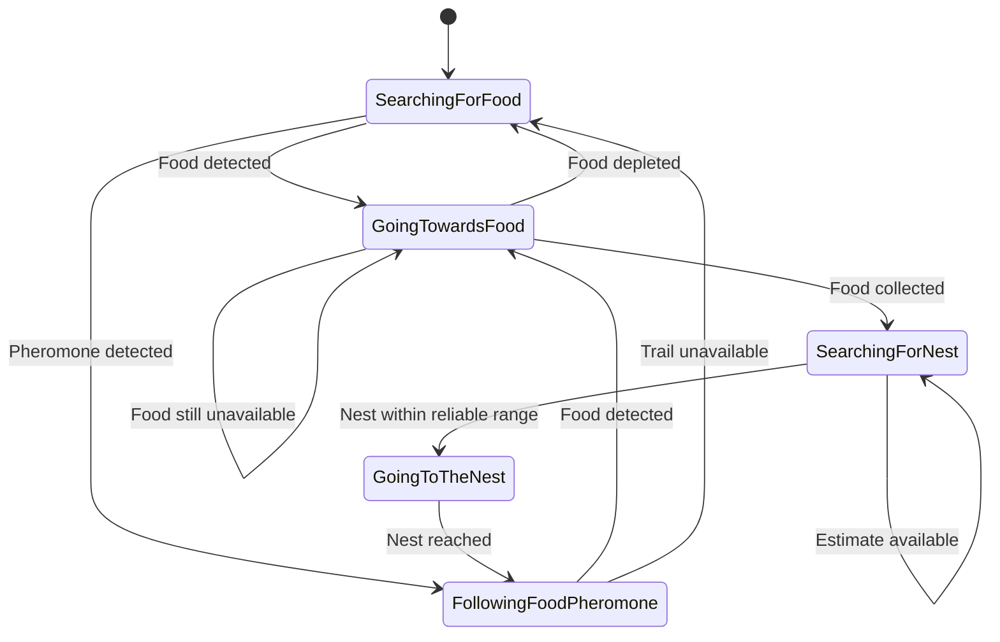

The state machine separates **high-level intent** from the movement calculation.

For example:

- `SearchingForFood` controls exploration.
- `GoingTowardsFood` converts the known food position into a movement direction.
- `SearchingForNest` uses the ant's internal nest estimate.
- `GoingToTheNest` uses the detected nest direction.
- `FollowingFoodPheromone` converts local pheromone information into a movement direction.

This makes adding or changing behavior considerably easier than embedding every rule into one movement function.

---

# 4. Navigation Under Uncertainty

One of the more interesting parts of the simulation is the return journey.  <br>
An ant does not use the nest's world position as a normal pathfinding target while it is away from the nest.

Instead, it maintains an internal estimate of the nest direction:

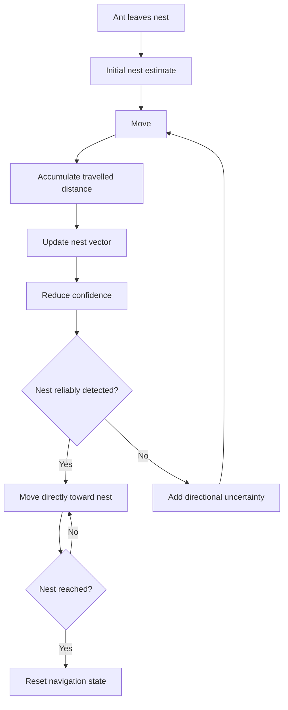

The estimate is updated from the ant's own movement:

```text
nestVector ← nestVector - movement + uncertainty
```

The ant also tracks:

- `distanceTravelledFromNest`
- `nestDirectionConfidence`
- `maxReliableDistance`

Confidence is calculated from the distance travelled:

```text
confidence = clamp01(
    1 - distanceTravelledFromNest / maxReliableDistance
)
```

As confidence decreases, the ant introduces more variation into its movement direction.

This creates a simple model of **navigation with an increasingly uncertain internal estimate**.

---

# 5. Nest Recovery Search

When the ant's estimate becomes sufficiently unreliable, it can transition into an expanding search around its estimated location.

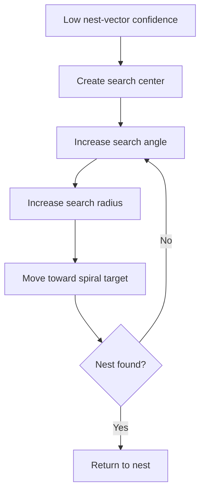

The search is generated procedurally from:

- Search center
- Search angle
- Search radius
- Search turning speed
- Search expansion speed

This avoids requiring a precomputed path or global navigation map.

---

# 6. Pheromone Trails

Pheromones are represented as a **numerical spatial field**.

Each cell stores food-pheromone intensity:

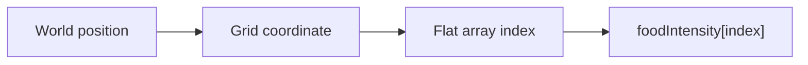

For a grid with width `W`:

```text
index = y × W + x
```

This provides a compact representation of the pheromone environment and avoids creating potentially thousands of scene objects.

### Depositing pheromones

When an ant is returning with food, it periodically deposits food pheromone at its current grid cell.

Deposits from the same ant are throttled for the same cell to prevent repeatedly reinforcing a single location every frame.

### Detecting pheromones

Each sensor searches its local circular region and calculates:

1. The average position of detected pheromone cells.
2. The strongest or weakest detected intensity, depending on configuration.
3. The number of detected cells.

The three sensor results are then combined into a target position.

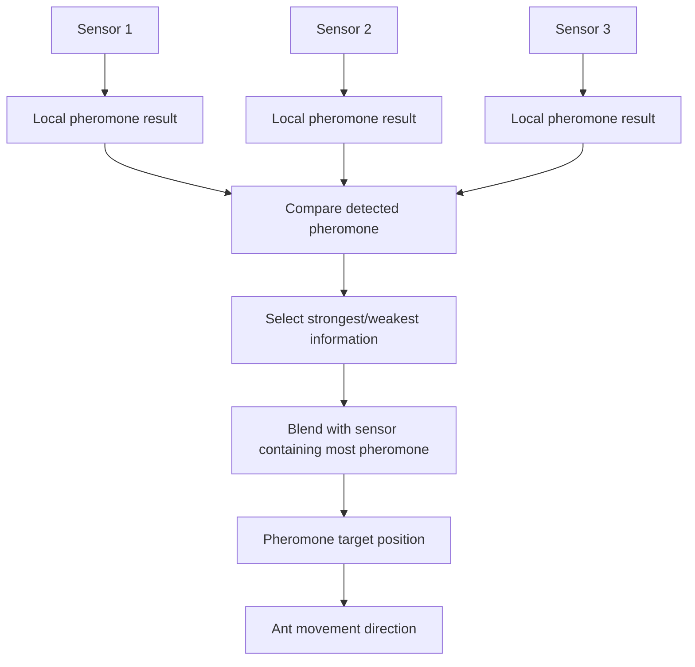

This is more than a simple nearest-object lookup: the ant receives an **aggregate directional signal** from its local pheromone field.

---

# 7. Pheromone Decay

Pheromone intensity is continuously reduced over time.

The system maintains a `HashSet<int>` containing cells that currently have active pheromone.

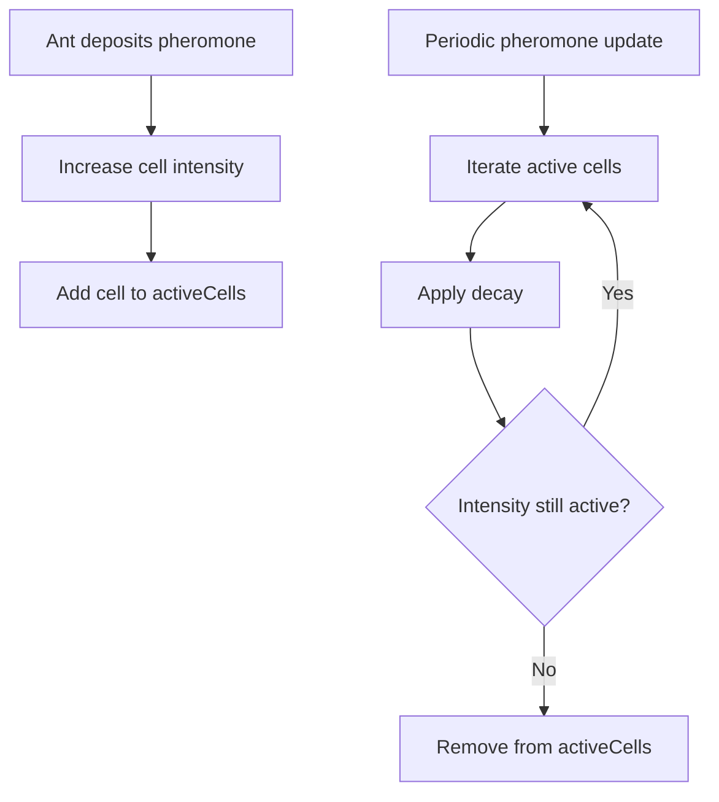

This is an example of **lazy spatial updating**.

Instead of scanning every cell in the entire grid on every update, the manager only considers cells that currently contain active pheromone.

That becomes increasingly useful as the simulation area grows while the pheromone-covered area remains relatively small.

---

# 8. Spatial Data Representation

The simulation uses flat arrays for grid-based environmental data. <br>
Current environmental data includes:

- Food amount
- Food pheromone intensity

The grid is used for efficient local queries while ant movement itself remains continuous.

---

# 9. Food Detection and Collection

Food is stored as an amount per spatial cell.  <br>
Food sources can cover multiple cells using a circular radius.

When an ant reaches a detected food location:

1. It requests one unit of food from `FoodSourceManager`.
2. The manager validates that food is still available.
3. The ant changes to its return behavior.
4. The ant begins depositing food pheromone.

The manager therefore remains the authoritative owner of food quantities.

---

# Architecture

The project was intentionally split into systems with focused responsibilities.

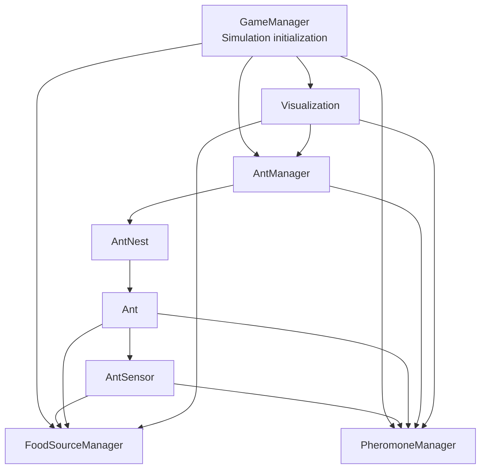

### Responsibilities

| System | Responsibility |
|---|---|
| `GameManager` | Initializes shared simulation systems and generates ant IDs |
| `AntManager` | Updates ants, selects behavioral states, and calculates movement |
| `AntNest` | Owns a colony's ants and controls spawning |
| `Ant` | Stores individual agent state and navigation information |
| `AntSensor` | Provides local environmental observations |
| `FoodSourceManager` | Stores food quantities and performs food queries/collection |
| `PheromoneManager` | Stores, queries, deposits, and decays pheromone intensity |
| `Visualization` | Draws ants, sensors, food, nests, and pheromone fields |
| `Utils` | Provides shared coordinate conversion and vector operations |

The separation is intentional: **ants decide how to behave, managers own shared environmental data, and visualization observes the simulation state.**

---

# Data Flow

A typical food-discovery cycle crosses the systems like this:

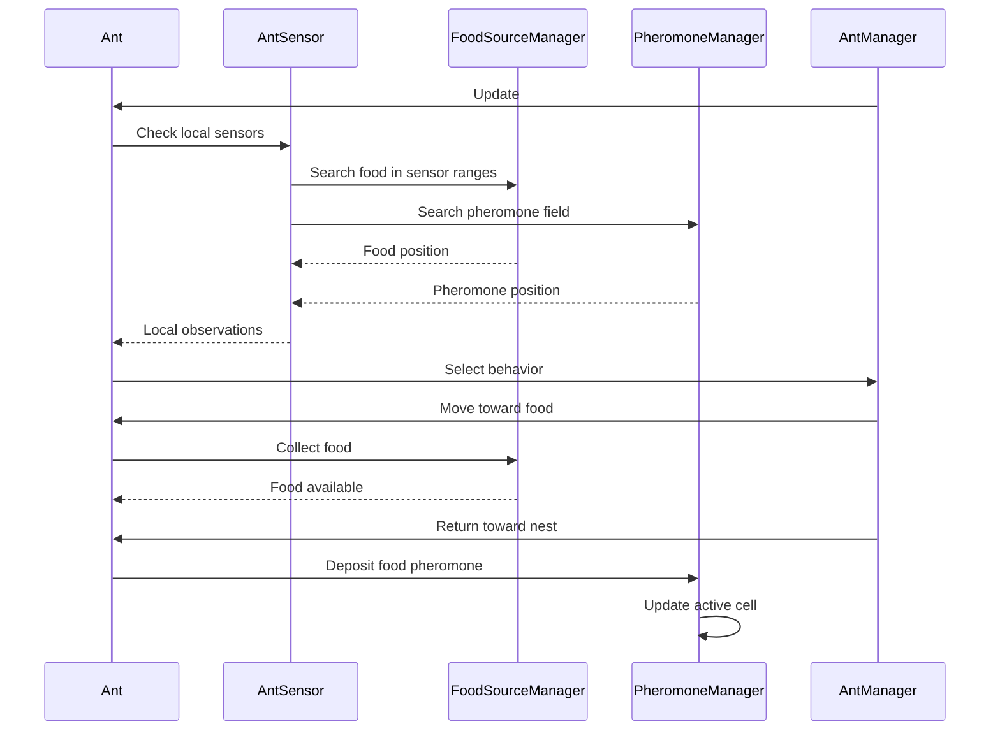

This makes the ownership boundaries explicit and keeps shared state out of the individual ant logic.

---

# Performance Considerations

The project is intentionally designed with simulation scale in mind.

### Lightweight agents

Ants are stored as C# structs rather than one `MonoBehaviour` per ant.

### Flat spatial storage

Grid data uses contiguous arrays:

```text
2D coordinate → integer index → array lookup
```

This avoids per-cell object allocation and makes the representation compact.

### Active-cell tracking

Pheromone decay uses:

```text
HashSet<int> activeCells
```

rather than iterating through every grid cell on every update.

### Bounded local queries

Ant sensors only inspect a local radius instead of scanning the complete environment.

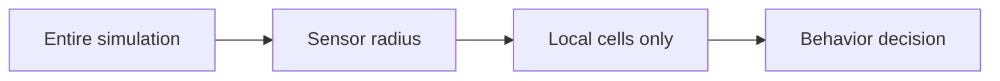

The result is a simulation architecture that can be scaled independently in several dimensions: **number of agents, environment size, and amount of active pheromone.**

---

# Configuration

Important simulation parameters are exposed through Unity's Inspector.

### Colony

- Maximum ants
- Spawn rate
- Movement-speed range

### Exploration

- Minimum random rotation
- Maximum random rotation
- Random rotation frequency

### Sensors

- Sensor radius
- Sensor distance
- Sensor angles

### Navigation

- Maximum reliable distance
- Maximum estimate deviation
- Nest search turn speed
- Nest search expansion speed

### Pheromones

- Deposit strength
- Maximum intensity
- Decay rate
- Update interval
- Strong/weak pheromone preference

This allows the same simulation to be used for experiments without modifying the underlying algorithms.

---

# Metrics

Each ant already maintains simulation metrics that can be used for future experiments:

| Metric | Purpose |
|---|---|
| `id` | Identify individual agents |
| `age` | Track agent lifetime |
| `tripsCompleted` | Measure successful nest/food cycles |
| `totalDistanceTraveled` | Measure movement efficiency |
| `distanceTravelledFromNest` | Estimate navigation uncertainty |
| `nestDirectionConfidence` | Observe navigation confidence |
| `lastFoodSourceDirectionConfidence` | Foundation for food-source memory |

The next step is to expose these metrics at the colony level so that different simulation configurations can be compared quantitatively.


# Current Limitations

Current limitations include:

- Only food pheromones are implemented.
- Ants currently use a simplified nest-direction estimate .
- Food-source memory exists in the ant state model but is not yet used as a complete fallback navigation strategy.
- Obstacle-based navigation is not currently implemented.
- Colony-level statistics are stored per ant but do not yet have a dedicated analysis interface.

These constraints are deliberate boundaries for the current version and provide clear directions for future experimentation.

---

# Roadmap

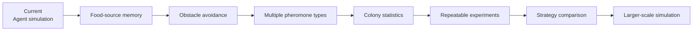

Planned work:

- [ ] Use remembered food-source direction when pheromone information disappears.
- [ ] Improve food-source confidence and memory decay.
- [ ] Add obstacle-aware movement.
- [ ] Add additional pheromone types.
- [ ] Add colony-level statistics and experiment summaries.
- [ ] Add repeatable simulation configurations.
- [ ] Compare different exploration strategies.
- [ ] Compare different pheromone-following strategies.
- [ ] Measure food retrieval rate, travel distance, and completed trips.
- [ ] Investigate scaling to larger colonies.
- [ ] Precompute masks for the sensor search.

The long-term goal is to turn the project into a small experimental platform for **collective behavior and agent-based algorithms**.

---

# Project Structure

```text
Assets/
└── Modules/
    ├── Ant/
    │   ├── Ant.cs
    │   └── AntSensor.cs
    │
    ├── Ant Manager/
    │   └── AntManager.cs
    │
    ├── Ant Nest/
    │   └── AntNest.cs
    │
    ├── Food Source/
    │   ├── FoodSource.cs
    │   └── FoodSourceManager.cs
    │
    ├── Game Manager/
    │   └── GameManager.cs
    │
    ├── Navigation/
    │   └── Directions.cs
    │
    ├── Pheromone/
    │   ├── Pheromone.cs
    │   └── PheromoneManager.cs
    │
    ├── Utils/
    │   └── Utils.cs
    │
    └── Visualization/
        └── Visualization.cs
```

---

# Running the Project

## Requirements

- **Unity 6000.4.11f1**
- Unity Hub
- Desktop platform supported by Unity 6

## Setup

1. Clone the repository.
2. Open the `Ant-simulator` folder in Unity Hub.
3. Open `Assets/Scenes/SampleScene.unity`.
4. Press **Play**.

Simulation parameters can be changed from the relevant objects in the Unity Inspector.

---

# Technologies

- **C#**
- **Unity 6**
- **Unity 2D URP**
- Git
